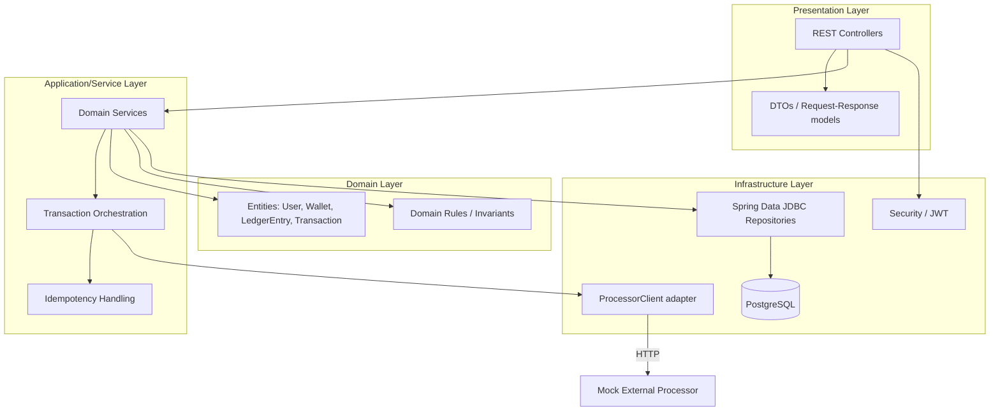
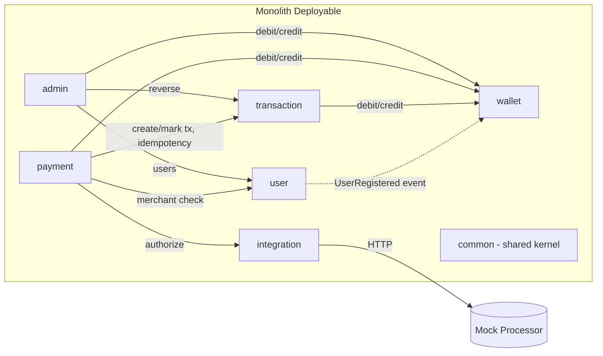
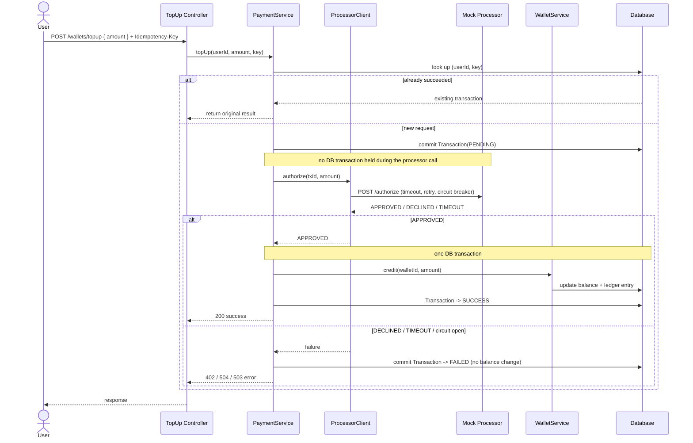
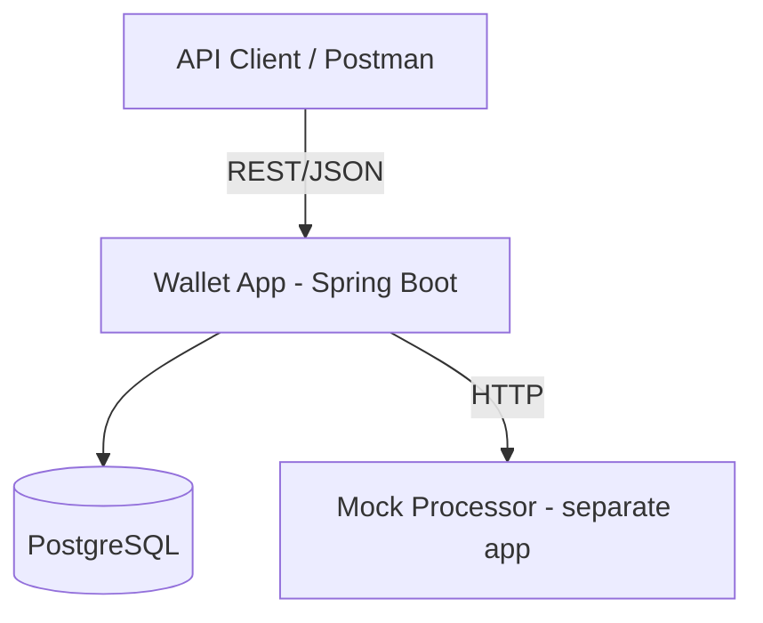
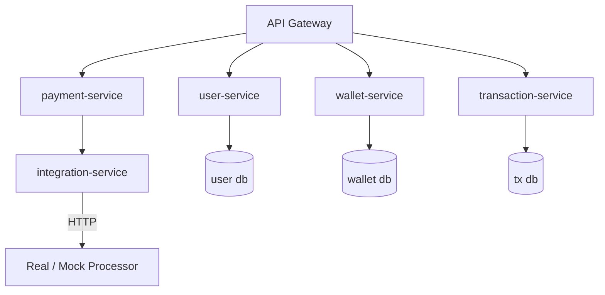

# High-Level Design (HLD)
## Digital Wallet — FinTech Intern Project

| Field | Value |
|---|---|
| Document | High-Level Design |
| Version | 1.1 |
| Stack | Java 17 / Spring Boot 3.4, Spring Data JDBC, PostgreSQL 16 |
| Architecture | Modular monolith (Spring Modulith), microservice-ready |
| Related | See SRS.md and LLD.md |

---

## 1. Architectural Goals

The system is a **modular monolith**: one deployable unit, internally divided into self-contained feature modules, each with its own layers. This is deliberately chosen so the team learns clean boundaries now and can extract modules into **microservices** later without rewriting business logic.

Design principles:
- **Layering** — every module follows Controller → Service → Repository → Domain.
- **Modularity** — modules talk to each other only through each other's `service` API (and published events), never by reaching into another module's repository, tables or web DTOs. This is **enforced by a test** (`ModularityTest`, Spring Modulith), not just by review.
- **Dependency direction** — dependencies point inward (web depends on service, service depends on domain). Domain classes carry only persistence-mapping annotations and protect their own invariants.
- **No dependency cycles between modules** — where a direct call would create one, the dependent module reacts to an event instead.
- **Externalized integration** — anything outside the system (the mock processor) is reached through one adapter, isolating the rest of the code from external changes.

---

## 2. Layered View

**Layer responsibilities**

| Layer | Responsibility | Must NOT do |
|---|---|---|
| Presentation | HTTP, request validation, map DTO ⇄ domain | Contain business rules |
| Service/Application | Business logic, orchestration, transaction boundaries | Handle HTTP or SQL details |
| Domain | Entities, invariants (e.g. balance ≥ 0); state changes only via domain methods | Depend on Spring beans/web; expose setters for invariant state |
| Infrastructure | Persistence, external HTTP, security | Contain business decisions |

---

## 3. Module View (microservice-ready boundaries)

Every module may also use `common`. Arrows point from the depending module to the module it calls; the dashed arrow is an event (wallet listens to user), so `user` itself depends only on `common`.

| Module | Owns | Future Microservice |
|---|---|---|
| **user** | Registration, login, roles, profile; publishes `UserRegistered` | `user-service` |
| **wallet** | Balances, ledger, atomic debit/credit; creates a wallet per registered user | `wallet-service` |
| **transaction** | Transaction records, P2P transfers, history, idempotency | `transaction-service` |
| **payment** | Top-up and merchant-payment orchestration | `payment-service` |
| **integration** | ProcessorClient adapter, retry, timeout, circuit breaker | `integration-service` / gateway |
| **admin** | User administration, transaction reversal | part of a back-office service |
| **common** | Error model, security (JWT, `AuthenticatedUser`), correlation ids, logging | shared library |

Each module is a top-level package (`com.alahly.momkn.finthos.<module>`) with sub-packages `web`, `service`, `domain`, `repository`. Only `service`, `domain` and the module's base package (events) are visible to other modules; `common` is an open shared kernel that depends on no module. The allowed dependencies are declared per module (`package-info.java`) and verified on every build — this is the seam along which microservices will later be split.

---

## 4. Request Flow — Top-up (representative money flow)

---

## 5. Deployment View

**Now (monolith):**

**Later (microservices target):**

The migration path: extract one module at a time, replace in-process service calls with REST/messaging (in-process events such as `UserRegistered` become messages), and give each service its own database. Because modules already avoid shared tables and their boundaries are test-enforced, this is incremental.

---

## 6. Cross-Cutting Concerns

| Concern | Approach |
|---|---|
| Security | Spring Security + JWT filter; the principal is an `AuthenticatedUser` (id, email, role), so modules never look the caller up again. Disabled users are rejected even with a valid token. Role-based access for `/api/admin/**`. |
| Transactions | Balance update + ledger entry always in one DB transaction (`LedgerService` requires an existing one). Processor-backed flows commit PENDING first, call the processor with no transaction open, then settle in one transaction; failures commit FAILED separately. |
| Idempotency | `Idempotency-Key` header required on money-moving endpoints and scoped per user. The DB unique constraint is the real enforcement; `IdempotencyService` is the fast path, rejects reuse with a different request, and resolves concurrent duplicates. |
| Resilience | Timeout + bounded retry + circuit breaker on ProcessorClient; failure ⇒ transaction FAILED, balance never touched. |
| Concurrency | Optimistic locking (`wallets.version`); a conflict returns 409 and the whole unit rolls back. |
| Error handling | Central `@RestControllerAdvice` mapping exceptions to HTTP codes; 5xx responses never expose internal details. |
| Logging | Correlation ID via filter/MDC (returned as `X-Correlation-Id` and in error bodies); structured logs at module boundaries. |
| Config | `application.yaml` with env-var overrides (DB, JWT secret, CORS origins); processor URL/timeout/retry externalized. |

---

## 7. Technology Choices

| Area | Choice | Why |
|---|---|---|
| Language | Java 17 | Records, modern APIs |
| Framework | Spring Boot 3.4 | Standard for FinTech backends |
| Data | Spring Data JDBC + PostgreSQL 16 | Explicit, aggregate-oriented persistence; relational integrity for money |
| Migrations | Flyway | Versioned schema (single baseline until a shared DB exists) |
| Modularity | Spring Modulith | Verifies module boundaries and cycles on every build; module docs |
| HTTP client | Spring `RestClient` | Calls to mock processor |
| Resilience | Spring Retry (`RetryTemplate`) + Resilience4j circuit breaker | Bounded retry and fail-fast when the processor is down |
| Auth | Spring Security + JWT (jjwt) | Simple, standard |
| Testing | JUnit 5, Mockito, MockWebServer, Testcontainers (PostgreSQL) | Unit + integration against the real database engine |
| Build | Maven (wrapper) | Team preference |

---

## 8. Risks & Mitigations

| Risk | Mitigation |
|---|---|
| Interns bypass module boundaries | `ModularityTest` fails the build on any cross-module access to internals or any cycle |
| Inconsistent balances on processor timeout | Never credit before APPROVED; FAILED committed independently of the money transaction |
| Processor approves but settlement fails (e.g. balance spent concurrently) | Transaction marked FAILED and logged at ERROR for reconciliation; automatic processor void is out of scope |
| Double charge on client retry | Required, per-user `Idempotency-Key` + unique constraint |
| Loss of audit trail | No cascading deletes into money history; users with history can only be disabled |
| Tests passing on a DB that behaves differently | Integration tests run on PostgreSQL via Testcontainers |
| Scope creep | Freeze scope to High-priority FRs in SRS |
| Hardcoded processor URL | Enforce externalized config (NFR) |
