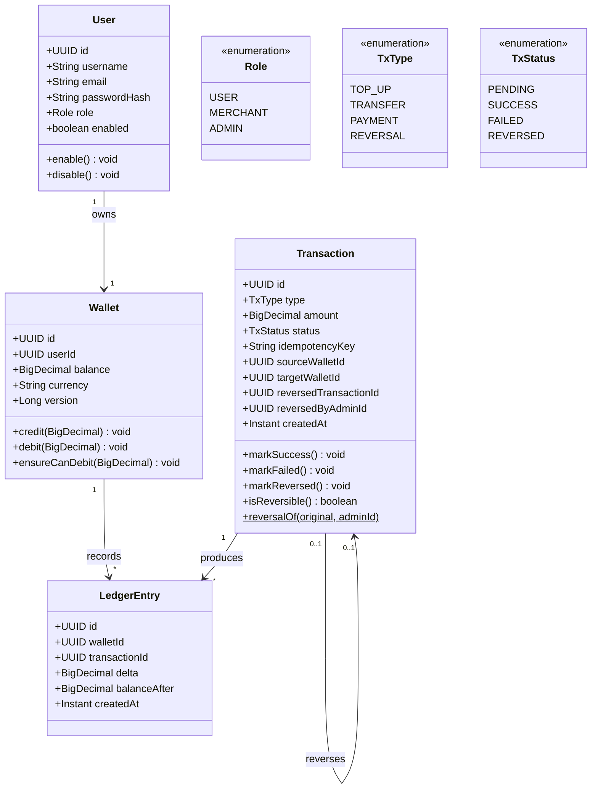
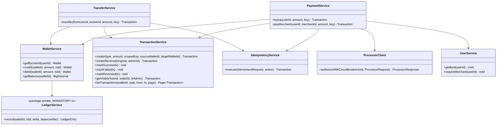
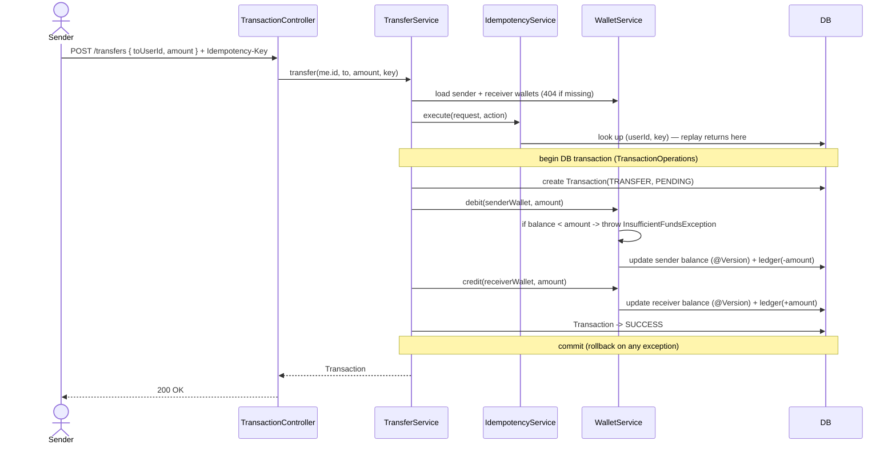
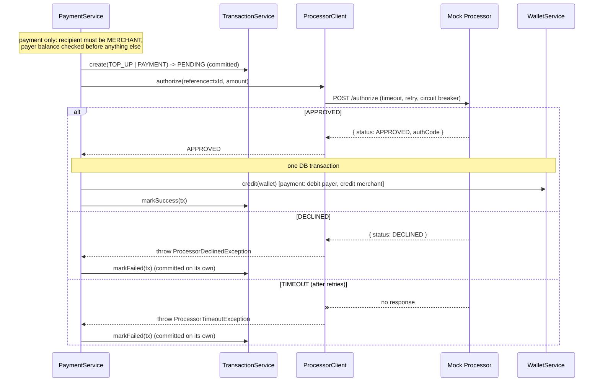
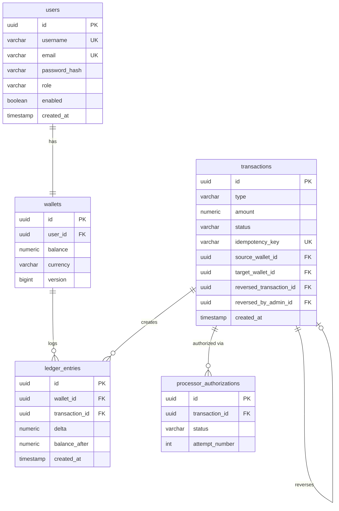

# Low-Level Design (LLD)
## Digital Wallet — FinTech Intern Project

| Field | Value |
|---|---|
| Document | Low-Level Design |
| Version | 1.1 |
| Stack | Java 17 / Spring Boot 3.4, Spring Data JDBC, PostgreSQL 16, Spring Modulith |
| Related | See SRS.md and HLD.md |

---

## 1. Package Structure

```
com.alahly.momkn.finthos
├── user                (UserRegistered event — module API)
│   ├── web             (AuthController, UserController, dto)
│   ├── service         (UserService, AuthService, UserDetailsServiceImpl)   ← exposed
│   ├── domain          (User, Role)                                          ← exposed
│   ├── mapper          (UserMapper)
│   └── repository      (UserRepository)
├── wallet
│   ├── web             (WalletController, dto)
│   ├── service         (WalletService; LedgerService, UserRegistrationListener are package-private) ← exposed
│   ├── domain          (Wallet, LedgerEntry)                                 ← exposed
│   ├── mapper          (WalletMapper)
│   └── repository      (WalletRepository, LedgerRepository)
├── transaction
│   ├── web             (TransactionController, dto)
│   ├── service         (TransactionService, TransferService, IdempotencyService, IdempotentRequest) ← exposed
│   ├── domain          (Transaction, TxType, TxStatus)                       ← exposed
│   └── repository      (TransactionRepository)
├── payment
│   ├── web             (PaymentController, TopUpController, dto)
│   └── service         (PaymentService)
├── integration
│   ├── client          (ProcessorClient, ProcessorRequest, ProcessorResponse) ← exposed
│   ├── config          (ProcessorProperties, ProcessorConfig)
│   ├── domain          (ProcessorAuthorization, AuthorizationStatus)
│   └── repository      (ProcessorAuthorizationRepository)
├── admin
│   ├── web             (AdminController, dto)
│   └── service         (AdminService)
└── common              (OPEN shared kernel — depends on no other module)
    ├── security        (JwtAuthenticationFilter, JwtService, SecurityConfig, AuthenticatedUser)
    ├── error           (GlobalExceptionHandler, ApiError, business exceptions)
    ├── config          (CorrelationIdFilter)
    └── logging         (LoggingAspect)
```

**Boundary rules (enforced by `ModularityTest`):**
- Other modules may use only the packages marked *exposed* (`@NamedInterface` in their `package-info.java`) and the module's base package (events). `web`, `mapper`, `config`, `repository` are always internal.
- Each module declares its allowed dependencies in its base `package-info.java`:

| Module | May depend on |
|---|---|
| user | common |
| wallet | common, user (event) |
| transaction | common, wallet |
| integration | common |
| payment | common, user, wallet, transaction, integration |
| admin | common, user, wallet, transaction |

- Controllers obtain the caller via `@AuthenticationPrincipal AuthenticatedUser` (id, email, role).

---

## 2. Domain Model (class diagram)



**Key invariants:**
- `Wallet.debit` (via `ensureCanDebit`) throws `InsufficientFundsException` if `balance - amount < 0`. Money is always `BigDecimal`, never `double`.
- Entities have getters only — no public setters and private builders/constructors. Balances and statuses change only through the domain methods above. Entities carry Spring Data mapping annotations (`@Table`, `@Id`, `@Version`, `Persistable`) and nothing else from Spring; equality is by `id`.
- `Transaction.isReversible()` — only `SUCCESS` transactions that are not themselves `REVERSAL`s.

---

## 3. Service Layer Design (class diagram)



**`IdempotencyService.execute`** scopes the client key to the user (`"<userId>:<key>"`, key ≤ 200 chars), then:
1. If a transaction with that key exists: same type/amount/target → return it if `SUCCESS`/`REVERSED`; `PENDING` → 409 `IDEMPOTENCY_REQUEST_IN_PROGRESS`; `FAILED` → 409 `IDEMPOTENCY_PREVIOUS_ATTEMPT_FAILED`; different request → 422 `IDEMPOTENCY_KEY_REUSED_WITH_DIFFERENT_REQUEST`.
2. Otherwise run the action. If it loses a concurrent race on the unique constraint (`DuplicateKeyException`), re-read and apply step 1 to the winner's row.

---

## 4. Detailed Flow — P2P Transfer (atomic, no external processor)



If any step throws, the whole unit rolls back — no partial transfer and no transaction row. The DB transaction is opened *inside* the idempotency guard so a duplicate-key race rolls back cleanly before the winning row is read. An optimistic-lock conflict returns 409 `CONCURRENT_MODIFICATION`; retrying with the same key is safe.

---

## 5. Detailed Flow — Top-up / Merchant Payment (with mock processor)



`PaymentService` is deliberately **not** `@Transactional` as a whole: no DB transaction or connection is held during the processor call, and the `FAILED` status survives because it is not part of a transaction that rolls back. If settlement fails *after* `APPROVED` (e.g. the balance was spent concurrently), the transaction is marked `FAILED` and logged at ERROR for reconciliation.

---

## 6. REST API Contract

`docs/openapi.yaml` is the source of truth; summary:

| Method | Path | Auth | Body / Notes | Success |
|---|---|---|---|---|
| POST | `/api/auth/register` | none | username, email, password | 201 |
| POST | `/api/auth/login` | none | email, password → JWT | 200 |
| GET | `/api/users/me` | user | — | 200 profile |
| GET | `/api/wallets/me` | user | — | 200 balance |
| POST | `/api/wallets/topup` | user | amount, `Idempotency-Key` header | 200 |
| POST | `/api/transfers` | user | toUserId, amount, `Idempotency-Key` | 200 |
| POST | `/api/payments` | user | merchantId, amount, `Idempotency-Key` | 200 |
| GET | `/api/transactions?type=&from=&to=&page=&size=` | user | filters + pagination | 200 |
| GET | `/api/transactions/{id}` | user | own transactions only (admins: any) | 200 |
| GET | `/api/admin/users?page=&size=` | admin | — | 200 |
| PATCH | `/api/admin/users/{id}/disable` | admin | toggles enabled | 200 |
| DELETE | `/api/admin/users/{id}` | admin | only users without transaction history | 204 |
| POST | `/api/admin/transactions/{id}/reverse` | admin | — | 200 |

Amounts: `≥ 0.01`, at most 15 integer digits and 4 decimal places.

**Standard error body:**
```json
{ "timestamp": "...", "status": 422, "error": "INSUFFICIENT_FUNDS", "message": "...", "correlationId": "..." }
```

**Error mapping (`GlobalExceptionHandler`):**
| Exception | HTTP | `error` |
|---|---|---|
| `MethodArgumentNotValidException` | 400 | `VALIDATION_ERROR` |
| `MissingRequestHeaderException` (e.g. no `Idempotency-Key`) | 400 | `MISSING_HEADER` |
| `IllegalArgumentException` (self-transfer, non-merchant recipient, blank key) | 400 | `BAD_REQUEST` |
| `AuthenticationFailedException` | 401 | `UNAUTHORIZED` |
| `AccessDeniedException` | 403 | `FORBIDDEN` |
| `EntityNotFoundException` | 404 | `NOT_FOUND` |
| `EmailAlreadyExistsException` / `UsernameAlreadyExistsException` | 409 | `EMAIL_ALREADY_EXISTS` / `USERNAME_ALREADY_EXISTS` |
| `InvalidTransactionStateException` (not reversible, user has history) | 409 | `INVALID_STATE` |
| `IdempotencyConflictException` (in progress / previous attempt failed) | 409 | `IDEMPOTENCY_…` |
| `OptimisticLockingFailureException` | 409 | `CONCURRENT_MODIFICATION` |
| `DataIntegrityViolationException` | 409 | `CONFLICT` |
| `IdempotencyConflictException` (key reused with different request) | 422 | `IDEMPOTENCY_KEY_REUSED_WITH_DIFFERENT_REQUEST` |
| `InsufficientFundsException` | 422 | `INSUFFICIENT_FUNDS` |
| `ProcessorDeclinedException` | 402 | `PROCESSOR_DECLINED` |
| `ProcessorUnavailableException` (circuit open) | 503 | `PROCESSOR_UNAVAILABLE` |
| `ProcessorTimeoutException` | 504 | `PROCESSOR_TIMEOUT` |
| anything else | 500 | `INTERNAL_ERROR` (generic message; details only in logs) |

---

## 7. Database Schema

The authoritative diagram is `docs/ERD.mermaid`; the DDL is `src/main/resources/db/migration/V1__baseline.sql`.



Notes:
- `wallets.version` → Spring Data JDBC `@Version` optimistic locking to prevent lost updates on concurrent balance changes.
- `transactions.idempotency_key` → UNIQUE; stores `"<user id>:<client key>"`, so keys are scoped per user (FR-7).
- `balance`, `amount`, `delta` → `NUMERIC(19,4)`, mapped to `BigDecimal`; `CHECK balance >= 0` and `CHECK amount > 0` back up the domain rules.
- Deletion policy: only `wallets → users` cascades. FKs into and out of `transactions`, `ledger_entries` and `processor_authorizations` are restrictive — money history is never deleted.
- Migrations: while there is no shared/production database the schema is a single `V1__baseline.sql`, edited in place (reset locally with `docker compose down -v`). Switch to append-only migrations once one exists.

---

## 8. Mock Processor — Integration Notes (for interns)

The mock is a **separate application** the interns build. The wallet system depends only on the `ProcessorClient` adapter and this contract:

```
POST {processor.base-url}/authorize
Request : { "reference": "<txId>", "amount": 100.00, "currency": "USD" }
Reply   : { "reference": "<txId>", "status": "APPROVED|DECLINED|TIMEOUT", "authCode": "..." }
```

Suggested ways to build the mock (pick one):
- A tiny separate Spring Boot app with one controller that decides the response by a rule (e.g. amount ending in `.00` → APPROVED, `.13` → DECLINED, `.99` → sleep to force TIMEOUT).
- A **WireMock** stub with scenario mappings.
- A Docker container so it can be started alongside the app via `docker-compose`.

**ProcessorClient (as implemented):**
- `RestClient` with connect/read timeout = `processor.timeout-ms`.
- `authorizeWithRetry` uses a programmatic `RetryTemplate` (`retry-count` attempts, `retry-delay-ms` fixed backoff, retries only on `ProcessorTimeoutException`; `DECLINED` is never retried). It is programmatic rather than `@Retryable` because the circuit-breaker method calls it on `this`, which would bypass a retry proxy.
- `authorizeWithCircuitBreaker` (Resilience4j instance `processor`) wraps the retrying call; when open it fails fast with `ProcessorUnavailableException` (503).
- Every attempt is recorded in `processor_authorizations` (`attempt_number`, status, auth code).

**Config (`application.yaml`):**
```yaml
processor:
  base-url: http://localhost:8072   # swap for real gateway later
  timeout-ms: 2000
  retry-count: 3
  retry-delay-ms: 500

resilience4j:
  circuitbreaker:
    instances:
      processor:
        base-config: default        # 50% failure rate over 10 calls, 10s open
```

> The whole point: the wallet code never knows whether it is talking to a mock or a real bank. Only `base-url` changes.

---

## 9. Testing Strategy

| Level | Scope | Tools |
|---|---|---|
| Unit | Wallet invariants, service logic (processor and repositories mocked) | JUnit 5, Mockito |
| Integration | Full money flows against a real PostgreSQL 16 (Testcontainers, one shared container); processor client against an HTTP stub | Testcontainers, MockWebServer |
| API | Endpoint contracts, error codes, idempotency | Spring MockMvc |
| Architecture | Module boundaries and dependency cycles | Spring Modulith (`ModularityTest`) |

Integration tests need Docker running. `./mvnw clean verify` runs everything.

**Must-cover cases:** transfer with insufficient funds, top-up APPROVED, top-up DECLINED, top-up TIMEOUT (each asserting balance unchanged *and* the `FAILED` row persisted on failure), duplicate idempotency key, idempotency key reused with a different request, same key used by different users, concurrent transfers (optimistic lock), retries through the circuit-breaker path, payment to a non-merchant, reversal (balances restored, audit fields set, cannot reverse twice), deleting a user with history refused.

---

## 10. Suggested Build Order (for interns)

1. Project skeleton + packages + DB (Flyway) + User/Auth.
2. Wallet module: entity, balance, ledger, credit/debit with tests.
3. Transaction module: P2P transfer (atomic) + history.
4. Integration module: `ProcessorClient` + config (point at a stub).
5. Payment module: top-up + merchant payment using the processor.
6. Idempotency, error handling, correlation-id logging.
7. Integration tests against the mock; admin reversal last.
